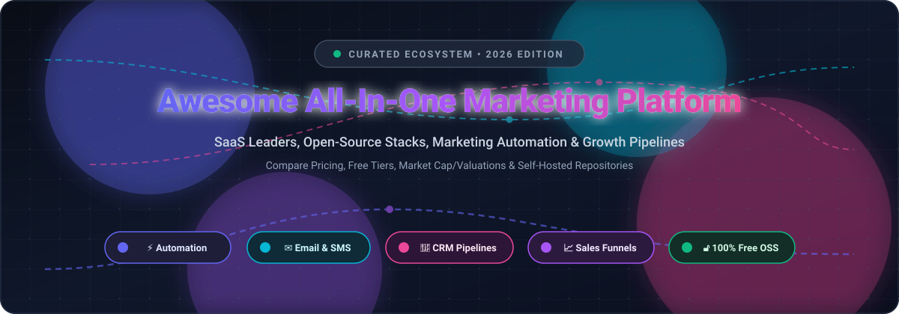

  

# 🚀 Awesome All-In-One Marketing Platform

  <strong>🔥 The Ultimate Curated Directory of All-in-One Marketing Platforms, Marketing Automation Suites, CRM Pipelines &amp; Open-Source Growth Tech Stacks</strong>

  
  
  
  
  
  
  

  <a href="#-sector-overview--market-dynamics">Sector Overview</a> •
  <a href="#-saashosted-platforms">SaaS Platforms &amp; Pricing</a> •
  <a href="#-open-source-github-projects">Open-Source Alternatives</a> •
  <a href="#-features--stack-comparison">Stack Comparison</a> •
  <a href="#-how-to-contribute">Contribute</a> •
  <a href="#-support--sponsor">Support</a>

---

## 📌 Executive Summary

Welcome to the **Awesome All-In-One Marketing Platform** hub! This SEO-optimized reference guides growth engineers, CMOs, digital marketers, indie hackers, and software architects through evaluating **SaaS marketing clouds** alongside **production-ready open-source platforms**.

Whether your priority is finding an enterprise growth suite with turnkey AI copilots (like HubSpot or ActiveCampaign) or achieving total data autonomy through self-hosted privacy-first software (like Mautic, Listmonk, or Twenty CRM), this guide covers concrete starting tier pricing, explicit free trial / forever-free limits, company valuations, and repository popularity.

---

## 📑 Table of Contents

- [📊 Sector Overview & Market Dynamics](#-sector-overview--market-dynamics)
- [🏢 SaaS/Hosted Platforms](#-saashosted-platforms)
- [💻 Open-Source GitHub Projects](#-open-source-github-projects)
- [🔍 Key Evaluation Criteria: SaaS vs. Self-Hosted](#-key-evaluation-criteria-saas-vs-self-hosted)
- [🤝 How to Contribute](#-how-to-contribute)
- [⭐ Star History](#-star-history)
- [💖 Support & Sponsor](#-support--sponsor)
- [⚖️ Disclaimer & Compliance](#-disclaimer--compliance)

---

## 📊 Sector Overview & Market Dynamics

The global marketing automation and all-in-one marketing platform sector is valued at approximately **$8.1B to $8.4B** and is projected to expand past **$15B–$20B+** by the early 2030s, compounding at an estimated **11.5% to 15.3% CAGR**.

### 🧩 Market Concentration vs. Fragmentation Analysis
- **Concentrated at the Enterprise Apex:** The upper enterprise segment demonstrates **moderate oligopolistic concentration**, where a cluster of heavyweight software vendors (HubSpot, Salesforce Marketing Cloud, Adobe Marketo, and Oracle Eloqua) command significant market share through deeply integrated CRM ecosystems and multi-cloud data fabrics.
- **Highly Fragmented Across SMBs & Mid-Market:** The lower and middle market remains **intensely fragmented**. Thousands of agile software vendors, funnel engines, and niche automation tools compete fiercely. Concurrently, the rise of modern **composable open-source tech stacks** (combining self-hosted CRMs, event queues, and high-volume dispatchers) provides companies with transparent alternatives to escalating per-contact SaaS pricing.

---

## 🏢 SaaS/Hosted Platforms

The following comparative table details the leading proprietary all-in-one marketing platforms, sorted in descending order by **company size (market capitalization / valuation / annual recurring revenue)**.

| 🏷️ Platform | 💼 Company Size (Valuation / Revenue) | 💵 Starting Tier Pricing | 🎁 Free Tier Limits & Free Trial Duration | 🎯 Target Audience & Differentiators |
| :--- | :--- | :--- | :--- | :--- |
| **[HubSpot Marketing Hub](https://www.hubspot.com/products/marketing)** | **~$20B–$30B market cap** (~$3.13B ARR) | **$20/month** (Starter tier, billed annually) | **Free forever plan**: up to 2,000 email sends/month, 2 user seats, basic forms, contact management CRM, and landing pages (workflow automations require paid tier). | Teams wanting the most integrated marketing suite with native CRM; advanced journey workflows unlock at Professional ($890/mo). |
| **[Zoho Marketing Automation](https://www.zoho.com/marketingautomation/)** | **~$12.5B valuation** (~$1.5B ARR, bootstrapped) | **$10/month** (Zoho Campaigns standard tier) | **Free forever plan**: up to 2,000 contacts and 6,000 email sends/month; free CRM tier supports up to 3 user seats. Paid tiers offer a 14-day free trial. | Organizations seeking cost-effective marketing automation fully unified with the extensive, bootstrapped Zoho business ecosystem. |
| **[Mailchimp](https://mailchimp.com/)** | **$12B acquisition** by Intuit (~$800M+ ARR) | **$13/month** (Essentials plan for 500 contacts) | **Free forever plan**: strictly capped at 250 contacts and 500 email sends/month (daily limit: 250). Paid plans offer a 14-day free trial. | SMBs and content creators wanting an established, user-friendly platform with hundreds of pre-built integrations and creative tools. |
| **[ActiveCampaign](https://www.activecampaign.com/)** | **$3B valuation** (~$250M ARR) | **$15/month** (Starter tier for 1,000 contacts, billed annually) | **14-day free trial** with access to core email marketing and conditional automation workflows (no credit card required; no permanent free plan). | Teams requiring advanced conditional branching, automation workflows, and ML-assisted lead scoring without full enterprise pricing. |
| **[GoHighLevel](https://www.gohighlevel.com/)** | **~$1.3B valuation** (~$150M+ ARR) | **$97/month** (Starter tier) | **14-day free trial** with full feature access across CRM, funnels, and automated appointment workflows (no permanent free tier). | Agencies and marketing consultants wanting an all-in-one white-label CRM and marketing automation engine with unlimited sub-accounts. |
| **[Brevo](https://www.brevo.com/)** | **~$1.0B+ valuation** (~$220M ARR) | **$9/month** (Starter tier) | **Free forever plan**: up to 100,000 stored contacts with a sending cap of 300 emails/day (includes Brevo watermark badge). | SMBs needing cost-effective multi-channel marketing (Email, SMS, WhatsApp) billed by dispatch volume rather than contact list size. |
| **[ClickFunnels](https://www.clickfunnels.com/)** | **~$360M valuation** (~$120M ARR) | **$97/month** (Launch plan, or $81/mo billed annually) | **14-day free trial** (plus 30-day money-back guarantee; no permanent free tier). Limited to 1 workspace, 10,000 contacts, and 50,000 emails/month. | Direct-response marketers and entrepreneurs focused on high-converting sales funnels, one-click upsells, order bumps, and webinars. |
| **[GetResponse](https://www.getresponse.com/)** | **~$150M ARR** (Privately held / Bootstrapped) | **$19/month** (Email Marketing plan for 1,000 contacts) | **Free forever plan**: up to 500 contacts and 2,500 newsletter sends/month with 1 landing page. Full paid suite offers a 30-day free trial. | SMBs wanting email marketing paired with built-in webinars, AI website/landing page builders, and ecommerce conversion funnels. |
| **[Keap](https://keap.com/)** | **$80M acquisition** by Thryv (~$85M ARR) | **$159/month** (Pro plan for 1,500 contacts and 2 users) | **14-day free trial** with CRM, sales pipeline, and marketing automation testing (no permanent free tier). | Established service businesses, consultants, and agencies wanting deep CRM pipelines tightly unified with automated billing and follow-ups. |
| **[Kartra](https://home.kartra.com/)** | **Sub-$10M ARR** ($1.5B+ cumulative GMV) | **$59/month** (Starter tier, or $79/mo billed monthly) | **14-day promotional trial** (often $1 or 14 days full access; no permanent free tier). Capped at 2,500 contacts and 15,000 emails/month. | Course creators and digital educators looking for an all-in-one suite combining checkouts, video hosting, membership portals, and funnels. |

---

## 💻 Open-Source GitHub Projects

Discover top open-source marketing engines, self-hosted newsletter managers, and CRM stacks. Repositories are sorted in descending order by **GitHub Stargazers Count**.

| 📦 Repository | 🌟 Stars_Count | 🛠️ Tech Stack | 📜 License | 💡 Architecture & Key Features |
| :--- | :--- | :--- | :--- | :--- |
| **[Twenty](https://github.com/twentyhq/twenty)** |  | TypeScript, NestJS, React, PostgreSQL | AGPL-3.0 | Modern CRM and customer platform built as a 100% open-source alternative to Salesforce and HubSpot. Provides custom fields, visual pipeline management, relational contact graphs, and rich workflow automation triggers. |
| **[Novu](https://github.com/novuhq/novu)** |  | TypeScript, Node.js, React, Redis | MIT | Complete open-source notification and workflow orchestration infrastructure. Powers multi-channel messaging (Email, SMS, Push, In-App Chat, Webhooks) with visual workflow builders, digests, and delay mechanics. |
| **[Chatwoot](https://github.com/chatwoot/chatwoot)** |  | Ruby on Rails, Vue.js, PostgreSQL | MIT | Customer engagement and omnichannel live chat platform. Consolidates inbound conversations across website widgets, email, WhatsApp, Facebook, and Twitter with CRM contact syncing and agent routing. |
| **[Listmonk](https://github.com/knadh/listmonk)** |  | Go, PostgreSQL | AGPL-3.0 | High-performance newsletter and mailing list manager. Sends millions of emails with ultra-low memory usage (~57 MB RAM peak), SQL-powered segmentation, multi-threaded worker queues, and REST/webhook APIs. |
| **[Postal](https://github.com/postalserver/postal)** |  | Ruby, MariaDB, RabbitMQ | GPL-3.0 | Fully featured open-source mail delivery platform and SMTP server designed as a self-hosted alternative to SendGrid, Postmark, and Mailgun for transactional and outbound marketing mail. |
| **[Mautic](https://github.com/mautic/mautic)** |  | PHP, Symfony, MySQL | GPL-3.0 | Enterprise-grade marketing automation engine deployed by 40,000+ organizations. Full lead tracking, dynamic segmentation, multi-step drip campaigns, landing pages, forms, and lead scoring. |
| **[GrowthBook](https://github.com/growthbook/growthbook)** |  | TypeScript, Next.js, Python | MIT | Open-source feature flagging and A/B testing growth platform. Enables marketing and growth teams to run statistically rigorous split tests and feature rollouts directly connected to existing data warehouses. |
| **[Mailtrain](https://github.com/Mailtrain-org/mailtrain)** |  | Node.js, MySQL / MariaDB | GPL-3.0 | Self-hosted newsletter application built on Node.js and Nodemailer. Supports large subscriber lists, custom form fields, click/open tracking, GPG encryption, and automation triggers via external webhooks. |
| **[Keila](https://github.com/pentacent/keila)** |  | Elixir, Phoenix, PostgreSQL | AGPL-3.0 | Clean, privacy-friendly email marketing and newsletter platform. Features block-based visual email editors, custom contact attributes, tag-based segmentation, anti-bot protection (hCaptcha), and reliable self-hosted delivery. |
| **[SendPortal](https://github.com/mettle/sendportal)** |  | PHP, Laravel, MySQL / PostgreSQL | MIT | Open-source marketing campaign manager and subscriber system. Connects directly to external SMTP providers (SES, SendGrid, Postmark, Mailgun) with detailed open/click tracking and segment tags. |
| **[Parcelvoy](https://github.com/parcelvoy/platform)** |  | TypeScript, Node.js, PostgreSQL | Apache-2.0 | Multi-channel customer engagement and marketing automation platform. Automates journeys across Email, SMS, and Push notifications with event-driven triggers and real-time user lifecycle tracks. |
| **[Autonnel](https://github.com/autonnel/autonnel)** |  | Astro, TypeScript, PostgreSQL | Apache-2.0 | Self-hosted sales funnel and checkout builder designed as an open-source ClickFunnels alternative. Features AI prompt-to-funnel generation, one-click upsells, order bumps, and server-side tracking. |
| **[Helio](https://github.com/achref-soua/helio)** |  | TypeScript, Python, PostgreSQL, ClickHouse | MIT | Full-stack AI-native growth platform and CDP. Features visual journey automation over Temporal DAGs, dynamic segmentation predicates, landing page builders, and MCP agent integration. |

---

## 🔍 Key Evaluation Criteria: SaaS vs. Self-Hosted

When selecting or architecting an all-in-one marketing infrastructure, consider these strategic trade-offs:

1. **💰 Pricing & Contact Creep**: Traditional SaaS platforms charge by contact count regardless of engagement status. Open-source platforms eliminate artificial subscriber taxes, allowing you to store millions of contacts at basic database server costs.
2. **🛡️ Data Sovereignty & GDPR Compliance**: Self-hosting your marketing database ensures that sensitive customer PII, event streams, and purchase data never leave your virtual private cloud (VPC).
3. **⚡ Deliverability & Infrastructure**: SaaS platforms offer shared IP warm-up and automated deliverability monitoring. Self-hosted platforms require proper SPF, DKIM, DMARC, and PTR alignment paired with reliable SMTP relays (e.g., AWS SES, Postmark, Mailgun, or self-hosted Postal).
4. **🧩 Composable Stacks vs. All-in-One Suites**: Modern engineering teams often achieve superior ROI by composing specialized open-source tools—for instance, pairing **Twenty** (CRM) with **Mautic** (Journeys), **Listmonk** (High-speed Broadcasts), and **GrowthBook** (A/B testing).

---

## 🤝 How to Contribute

Contributions are warmly welcomed! Help make this the most comprehensive and up-to-date marketing directory on GitHub:

1. 🍴 **Fork the repository**.
2. 🌿 **Create a feature branch** (`git checkout -b feature/add-new-platform`).
3. ✍️ **Add or update entries** in `README.md` (ensure adherence to the tabular format, including exact pricing, free tier limits, valuation, and verified stargazers).
4. 🚀 **Commit your changes** (`git commit -m "Add New Marketing Platform entry"`).
5. 📬 **Open a Pull Request** with a concise description of your additions.

---

## 📈 Star History

---

## 💖 Support & Sponsor

If this curated repository saved you time, informed your software procurement, or helped scale your growth stack:

- ⭐ **Star this repository** to help others discover it!
- 🍴 **Fork and share** with your network, colleagues, and marketing engineering teams.
- ☕ **Buy me a coffee / Sponsor the project**: Contributions directly fuel continued research and open-source maintenance. You can sponsor via the **[GitHub Sponsors Dashboard](https://github.com/sponsors/ishandutta2007)**.

Thank you for being part of our open-source and marketing technology community! 🌟

---

## ⚖️ Disclaimer & Compliance

- This repository is a **community-curated index** created for educational and comparative purposes. Inclusion does not constitute a formal commercial endorsement.
- All brand names, logos, and trademarks belong to their respective corporate owners.
- When capturing, storing, and marketing to leads, ensure strict compliance with regional data privacy laws (GDPR, CCPA, CASL) and anti-spam legislation (CAN-SPAM). Verified subscriber consent, double opt-in validation, and RFC-compliant one-click unsubscribe headers are mandatory best practices.

---

  Built with ❤️ for marketers, growth hackers, and software engineers worldwide.

